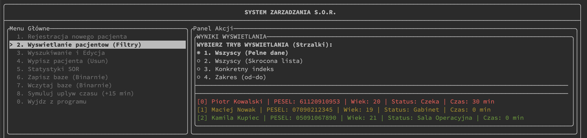

# System zarządzania SOR

Terminalowa aplikacja (TUI) w C++20 do obsługi kolejki pacjentów na Szpitalnym Oddziale Ratunkowym. Pacjenci mają priorytet triage (czerwony / żółty / zielony), status pobytu i czas oczekiwania. Dane można zapisać do pliku binarnego i wczytać z powrotem.



## Funkcje

- rejestracja pacjentów z walidacją danych (PESEL, wiek, priorytet)
- wyświetlanie listy w kilku trybach: pełne dane, skrócona lista, pojedynczy indeks, zakres
- wyszukiwanie po indeksie lub nazwisku oraz edycja statusu i priorytetu
- statystyki oddziału, np. średni wiek i średni czas oczekiwania według priorytetu
- zapis i odczyt bazy w formacie binarnym
- symulacja upływu czasu dla pacjentów w poczekalni

## Technologie i elementy techniczne

- **C++20**, **CMake** (FetchContent)
- **[FTXUI](https://github.com/ArthurSonzogni/FTXUI)** – interfejs w terminalu
- **SmartArray<T>** – własny szablon dynamicznej tablicy (reguła trzech, głęboka kopia, automatyczne powiększanie pojemności, `insert`, `erase`, `shrinkToFit`, kontrola zakresu w `at()`)
- serializacja binarna obiektów zawierających `std::string`
- testy jednostkowe w **Google Test**
- dokumentacja w formacie Doxygen

## Budowanie i uruchomienie

Wymagany jest kompilator obsługujący C++20 oraz CMake w wersji 3.20 lub nowszej. FTXUI pobiera się automatycznie.

```bash
git clone https://github.com/TWOJ-LOGIN/sor-manager.git
cd sor-manager
cmake -S . -B build
cmake --build build
./build/Projekt1
```

## Struktura projektu

```
include/   pliki nagłówkowe (Pacjent, SmartArray, SorManager, Interface)
src/       implementacja
tests/     testy jednostkowe
```

## Autor

Wiktor Hankus – student informatyki, Politechnika Krakowska
